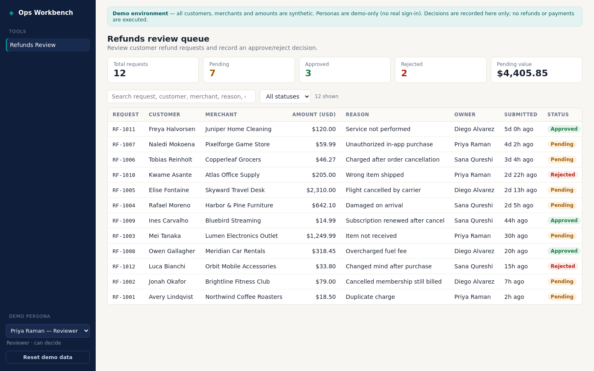

# Ops Workbench — internal tools demo

A small internal operations app for a fintech support team. The first module, **Refunds Review**, gives operators a
queue of refund requests (customer, merchant, amount in USD, reason, owner, submitted time, status) with search, a
status filter, summary counts and a detail drawer where a reviewer approves or rejects with a required reason and sees a
timestamped decision history.

> **Synthetic demo only.** Every customer, merchant and amount is fictional. No payments or refunds are executed —
> the app only records a decision. Personas are **demo-only** (a header the browser sends; no real sign-in/SSO). This
> prototype does not establish a production access model and makes no compliance (KYC, PCI, SOX…) claims. History is
> stored in an ordinary SQLite table; it is not tamper-proof/immutable auditing.



Baseline recording of the main journey: [docs/refunds-e2e-demo-v1.mp4](docs/refunds-e2e-demo-v1.mp4)

## Stack
- `backend/` — FastAPI + SQLite (stdlib `sqlite3`). Owns validation, permissions, state transitions and history.
- `frontend/` — Vite + React + TypeScript, no UI framework. Shared queue/drawer/history components.
- Single-service mode: if `frontend/dist` exists, the FastAPI app also serves the built UI (one port).

## Run locally
Requirements: Python 3.10+, Node 20+.

```bash
# backend
cd backend
python3 -m venv .venv && .venv/bin/pip install -r requirements-dev.txt
.venv/bin/python -m app.seed            # reset ALL tools to synthetic fixtures (repeatable)
.venv/bin/uvicorn app.main:app --port 8000

# frontend (dev, hot reload; proxies /api to :8000)
cd frontend && npm ci && npm run dev    # http://localhost:5173

# or single-service: build UI, then open http://localhost:8000
cd frontend && npm ci && npm run build
```

## Tests
```bash
cd backend && .venv/bin/python -m pytest -q          # API: permissions, reason, duplicates, persistence, isolation
cd frontend && npm run build && npx eslint src        # type-check + lint
cd backend && .venv/bin/python ../scripts/e2e.py      # browser journey (needs a running server + Chrome CDP; see script)
```

## Demo personas (server-controlled, demo-only)
| Persona | Role | Can decide |
|---|---|---|
| Priya Raman — Reviewer (demo) | reviewer | yes |
| Marcus Lee — Viewer (demo) | viewer | no (API returns 403) |

Defined in `backend/app/personas.py`. Unknown persona → 401. Anyone can pick a persona in the demo; that is the
intended demo behavior, **not** an access-control model.

## Rules enforced server-side
- Decisions only from `pending`; a second decision returns **409** and writes no history.
- Reason required (≥3 non-space chars) → **422** otherwise.
- Status update + history row are written in one `BEGIN IMMEDIATE` transaction (with a guarded `UPDATE … WHERE status=?`).
- Every query is scoped by tool key; reset only touches one tool.
- "Over 48 hours" filter (`?overdue=true`) and the "Pending over 48h" count include only `pending` requests submitted
  strictly more than 48h ago, oldest first; approved/rejected never appear. Works together with search and status.

## Demo reset
- CLI: `cd backend && .venv/bin/python -m app.seed [--tool refunds]`
- UI: **Reset demo data** button in the nav (calls `POST /api/demo/reset?tool=refunds`).
- Disable the endpoint with `DEMO_RESET_ENABLED=false`.
Seed ages are relative to reset time, so the 4 pending requests older than 48h stay >48h old after each reset.

## Persistence
Data lives in SQLite at `DB_PATH` (default `backend/data/app.db`). It survives process restarts on the same disk
(covered by a test). Whether it survives a **redeploy** depends on the host: on hosts without a persistent volume
(including the Devin session preview/ephemeral containers) a redeploy starts from a fresh, re-seeded database. Nothing
is stored in browser localStorage except the selected demo persona (a UI preference).

## Configuration
| Env var | Default | Purpose |
|---|---|---|
| `DB_PATH` | `backend/data/app.db` | SQLite file |
| `DEMO_RESET_ENABLED` | `true` | Allow `POST /api/demo/reset` |
| `CORS_ORIGINS` | `*` | Comma list when frontend is hosted separately |
| `FRONTEND_DIST` | `frontend/dist` | Built UI to serve from the API |
| `VITE_API_BASE_URL` (build-time) | empty (same origin) | Backend URL for a separately hosted frontend |

## Adding another module (e.g. Merchant Reviews)
See [AGENTS.md](AGENTS.md#adding-a-tool).
