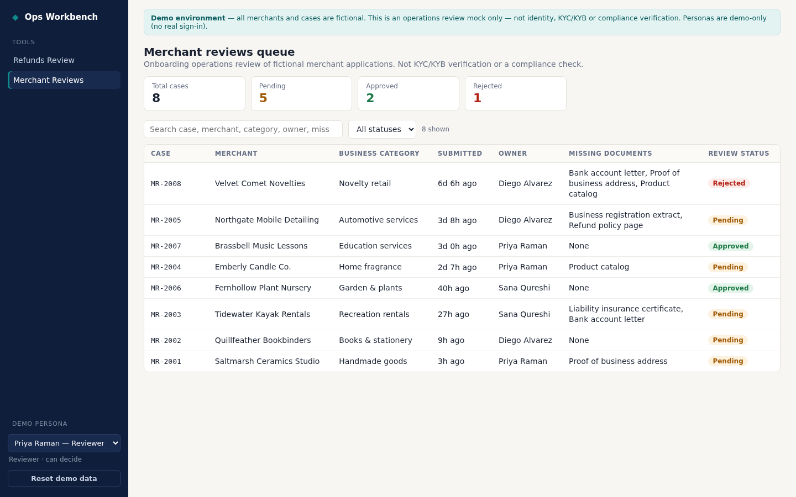

# Ops Workbench — internal tools demo

A small internal operations app for a fintech support team with two modules that share one backend workflow and one set
of UI components, switchable from the sidebar:

- **Refunds Review** (`/refunds`, default `/`) — queue of refund requests (customer, merchant, amount in USD, reason,
  owner, submitted time, status) with search, status filter, **Over 48 hours** filter and summary counts.
- **Merchant Reviews** (`/merchant-reviews`) — onboarding operations review queue of 8 fictional merchant cases
  (merchant name, business category, submitted date, owner, missing documents, review status). This is an operations
  review mock, **not** KYC/KYB, identity or compliance verification.

In both, a reviewer approves or rejects with a required reason in a detail drawer and sees a timestamped decision
history; viewers are view-only. Each module has its own records, history, search/filter/selection state and reset.

> **Synthetic demo only.** Every customer, merchant and amount is fictional. No payments or refunds are executed —
> the app only records a decision. Personas are **demo-only** (a header the browser sends; no real sign-in/SSO). This
> prototype does not establish a production access model and makes no compliance (KYC, PCI, SOX…) claims. History is
> stored in an ordinary SQLite table; it is not tamper-proof/immutable auditing.




Recordings: [docs/ops-workbench-e2e-demo-v3.mp4](docs/ops-workbench-e2e-demo-v3.mp4) (both modules, merchant decision,
refunds unchanged) · baseline refunds journey [docs/refunds-e2e-demo-v1.mp4](docs/refunds-e2e-demo-v1.mp4).
More screenshots: [viewer read-only](docs/07-merchant-viewer-readonly.png),
[merchant rejected + history](docs/08-merchant-rejected-history.png), [refunds over 48h](docs/04-over-48h.png).

## Stack
- `backend/` — FastAPI + SQLite (stdlib `sqlite3`). Owns validation, permissions, state transitions and history.
- `frontend/` — Vite + React + TypeScript, no UI framework. Shared queue/drawer/history components.
- Single-service mode: if `frontend/dist` exists, the FastAPI app also serves the built UI (one port).

## Run locally
Requirements: Python 3.10+, Node 20+.

Quick start (one service on :8000; creates `backend/.venv`, runs `npm ci` + build in `frontend/`, no global installs):
```bash
scripts/start-demo.sh                       # HOST=0.0.0.0 PORT=8000 RESET=1 (re-seed all tools) are optional
```

Manual steps:

```bash
# backend
cd backend
python3 -m venv .venv && .venv/bin/pip install -r requirements-dev.txt
.venv/bin/python -m app.seed            # reset ALL tools to synthetic fixtures (repeatable)
.venv/bin/uvicorn app.main:app --port 8000

# frontend (dev, hot reload; proxies /api to :8000)
cd frontend && npm ci && npm run dev    # http://localhost:5173

# or single-service: build UI, then open http://localhost:8000
cd frontend && npm ci && npm run build
```

## Tests
```bash
cd backend && .venv/bin/python -m pytest -q          # API: permissions, reason, duplicates, persistence, per-tool isolation
cd frontend && npm run build && npx eslint src        # type-check + lint
cd backend && .venv/bin/python ../scripts/e2e.py      # browser journey over both modules (needs a running server; see script)
```

## Demo personas (server-controlled, demo-only)
| Persona | Role | Can decide |
|---|---|---|
| Priya Raman — Reviewer (demo) | reviewer | yes |
| Marcus Lee — Viewer (demo) | viewer | no (API returns 403) |

Defined in `backend/app/personas.py`. Unknown persona → 401. Anyone can pick a persona in the demo; that is the
intended demo behavior, **not** an access-control model.

## Rules enforced server-side
- Decisions only from `pending`; a second decision returns **409** and writes no history.
- Reason required (≥3 non-space chars) → **422** otherwise.
- Status update + history row are written in one `BEGIN IMMEDIATE` transaction (with a guarded `UPDATE … WHERE status=?`).
- Every query is scoped by tool key; reset only touches one tool.
- "Over 48 hours" filter (Refunds only; `?overdue=true` returns 400 for tools without it) (`?overdue=true`) and the "Pending over 48h" count include only `pending` requests submitted
  strictly more than 48h ago, oldest first; approved/rejected never appear. Works together with search and status.

## Demo reset
- CLI: `cd backend && .venv/bin/python -m app.seed [--tool refunds]`
- UI: **Reset demo data** button in the nav resets the **currently open tool only** (`POST /api/demo/reset?tool=<key>`).
- Disable the endpoint with `DEMO_RESET_ENABLED=false`.
Seed ages are relative to reset time, so the 4 pending refunds older than 48h stay >48h old after each reset.
Merchant seed after reset: 8 cases — 5 pending, 2 approved, 1 rejected.

## Persistence
Data lives in SQLite at `DB_PATH` (default `backend/data/app.db`). It survives process restarts on the same disk
(covered by a test). Whether it survives a **redeploy** depends on the host: on hosts without a persistent volume
(including the Devin session preview/ephemeral containers) a redeploy starts from a fresh, re-seeded database. Nothing
is stored in browser localStorage except the selected demo persona (a UI preference).

## Configuration
| Env var | Default | Purpose |
|---|---|---|
| `DB_PATH` | `backend/data/app.db` | SQLite file |
| `DEMO_RESET_ENABLED` | `true` | Allow `POST /api/demo/reset` |
| `CORS_ORIGINS` | `*` | Comma list when frontend is hosted separately |
| `FRONTEND_DIST` | `frontend/dist` | Built UI to serve from the API |
| `VITE_API_BASE_URL` (build-time) | empty (same origin) | Backend URL for a separately hosted frontend |

## Per-tool differences
All behavior differences live in configuration, not forked code: backend `ToolConfig` (`backend/app/tools/<key>.py`)
and frontend `ToolUi` (`frontend/src/tools/index.ts`). Shared: `records`/`events` tables (scoped by `tool`), decision
endpoint (persona check, reason ≥3 chars, 409 on repeat, single transaction), queue/drawer/decision/history components.

| | Refunds Review | Merchant Reviews |
|---|---|---|
| Key / route | `refunds` / `/refunds` | `merchant_reviews` / `/merchant-reviews` |
| Columns | request, customer, merchant, amount, reason, owner, submitted, status | case, merchant, business category, submitted, owner, missing documents (`list`), review status |
| Seed | 12 refunds (`RF-10xx`) | 8 merchant cases (`MR-200x`) |
| `overdue_filter` | on (Over 48 hours + count) | off (hidden; API 400) |
| `value_field` | `amount_usd` (Pending value) | none (hidden) |
| `requester_field` (submitted event actor) | `customer` | `merchant_name` |
| Statuses / actions | pending → approved / rejected | same |
| Banner / decision footnote | no refunds or payments executed | operations review only, not KYC/compliance |

## Adding the next tool
1. Add `backend/app/tools/<key>.py` exporting a `ToolConfig` (columns, detail fields, search fields, statuses, actions,
   synthetic `seed`, and the `overdue_filter` / `value_field` / `requester_field` switches); register it in
   `backend/app/tools/__init__.py`. Seeding, reset, the API and the CLI pick it up automatically.
2. Add a `ToolUi` entry (key, `path`, labels, banner, reason placeholder, footnote) to `frontend/src/tools/index.ts`.
   The sidebar and route appear automatically; per-tool view state is isolated because `ToolView` is keyed by tool.
3. Copy `backend/tests/test_merchant_reviews.py` as a template: seed counts, viewer 403, reason 422, decision + 409,
   cross-tool snapshot isolation, per-tool reset. Extend `scripts/e2e.py` for the new route.

## Limitations
Synthetic prototype: demo personas (no SSO), SQLite single-node storage, history is not tamper-proof, no notifications or
document upload; "missing documents" is a static list on the case. Merchant Reviews is not a KYC/KYB or compliance tool.

## Built with Devin

See [the tested Devin workflow](docs/devin-workflow.md) for reusable Playbook templates, completed session/PR links, version tags and the actual setup interventions. The application was built by Devin; orchestration, review and presentation preparation were assisted by Codex.

## Presentation and decisions

- [Presentation webpage](docs/presentation/recording-guide.html): seven informational sections, integration examples, demo links and expandable presenter resources. Open the HTML locally or serve the repository to view it.
- [Key Decisions — one-page PDF](docs/presentation/key-decisions.pdf) ([editable text](docs/presentation/key-decisions.txt)): scope, architecture and tradeoffs for the hiring team.
- [Five-minute talking script](docs/presentation/talking-script.txt): introduction, Playbooks, Automations, completed app work, security and recommendation.
- [Security profile export](docs/presentation/security-profile.json): configured after the original prototype and bound to the disabled Health and integration automations; follow-up probes did not conclusively establish enforcement.

## Follow-up: controlled integration and access

The separately timed [Settlement Review sample](examples/settlement-review/README.md) demonstrates a simulated external vendor using OAuth client credentials, server-enforced demo roles and tenant isolation, and a restricted Devin automation that returns a patch for human publication. Its [governance notes](examples/settlement-review/docs/governance.md) distinguish configured controls from observed behavior. The vendor is simulated; the HTTP exchange and access checks are real. This extension does not change the original app or retroactively expand its reported build time.
